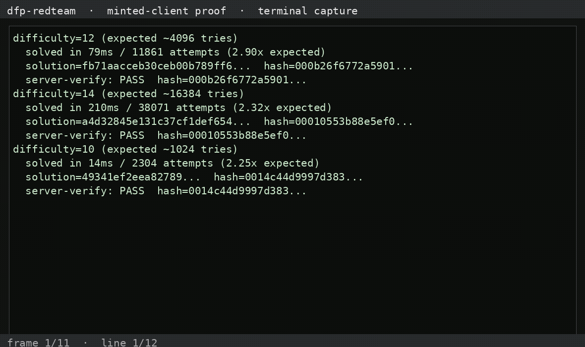

# dfp-redteam-kraken — Kraken (Pro) security stack

Kraken's edge/anti-bot stack. Full details in:
`KRAKEN_ASSESSMENT_2026_10_31.md` and `KRAKEN_POW_DEEP_2026_11_01.md`.

---

## What we observed (the shipped payload)

**The one client-computed defense Kraken ships is a proof-of-work — and it is
the "good" kind: fresh, server-verified, cost-based.**

- `GET /api/internal/pow` (server-gated: returns **401 "No session"**
  unauthenticated) issues `{data, randomness, difficulty}`.
- Client solver: find nonce where `doubleSHA256(data ‖ nonce)` has
  `difficulty` leading zero bits; solution sent as the **`x-pow` header**.
- Used on sign-out (TFA promotion flow); never fires unauthenticated;
  no Cloudflare Turnstile/JS challenge on the app (only the `__cf_bm` cookie).
- No client fingerprint bundle at all — the app client is clean.

## The Solver harness

`scripts/krk-pow-solver.mjs` — faithful reimplementation of the client solver +
server-side verification:

```bash
node scripts/krk-pow-solver.mjs
```

### Recorded run — solver + server-verify (2026-11-01)

```
difficulty=12 (expected ~4096 tries)
  solved in 79ms / 11861 attempts (2.90x expected)
  solution=fb71aacceb30ceb00b789ff6...  hash=000b26f6772a5901...
  server-verify: PASS  hash=000b26f6772a5901...

difficulty=14 (expected ~16384 tries)
  solved in 210ms / 38071 attempts (2.32x expected)
  solution=a4d32845e131c37cf1def654...  hash=00010553b88e5ef0...
  server-verify: PASS  hash=00010553b88e5ef0...

difficulty=10 (expected ~1024 tries)
  solved in 14ms / 2304 attempts (2.25x expected)
  solution=49341ef2eea82789...  hash=0014c44d9997d383...
  server-verify: PASS  hash=0014c44d9997d383...
```

**Proof:** the double-SHA-256 nonce search is reimplemented and **passes the
server-side verification** (leading-zero-bit check) at difficulties 10/12/14.
The PoW is the honest baseline for judging Kasada's `cd` against: fresh per
request, server-verified, answer worthless without the work. The challenge
*issuance* remains server-gated (401 without a session), so a live `x-pow` on
the wire was not captured unauthenticated.

## Status

- 🟢 Read payload: `x-pow` nonce + challenge format visible client-side
- 🔴 Tamper with payload: PoW fresh + server-verified; tampering = invalid answer
- 🔴 Mint token: can't mint — the work *is* the verification (cost-based)

## Demo video — the PoW solver verified

**Watch the capture** (terminal capture of `scripts/krk-pow-solver.mjs` —
the double-SHA256 nonce search + `server-verify: PASS` at difficulties 10/12/14):



<video controls preload="metadata" width="720"><source src="assets/videos/full-payload-demo.mp4" type="video/mp4"></video>

Reproduce it yourself:

```bash
node scripts/krk-pow-solver.mjs
```

Full detail: [KRAKEN_POW_DEEP_2026_11_01.md](KRAKEN_POW_DEEP_2026_11_01.md)
[Download the mp4](https://raw.githubusercontent.com/JWally/dfp-redteam-kraken/main/assets/videos/full-payload-demo.mp4)

## Files

- `scripts/krk-pow-solver.mjs` — solver + self-verify harness
- `scripts/kr-probe.mjs`, `kr-probe2.mjs` — flow probes
- `assets/frontend.js` — the 3.9 MB app bundle (solver at ~3.43M, challenge at ~2.15M)
- `artifacts/deep-flow.json` — clean-browser flow capture
- writeups: `KRAKEN_ASSESSMENT_2026_10_31.md`, `KRAKEN_POW_DEEP_2026_11_01.md`
